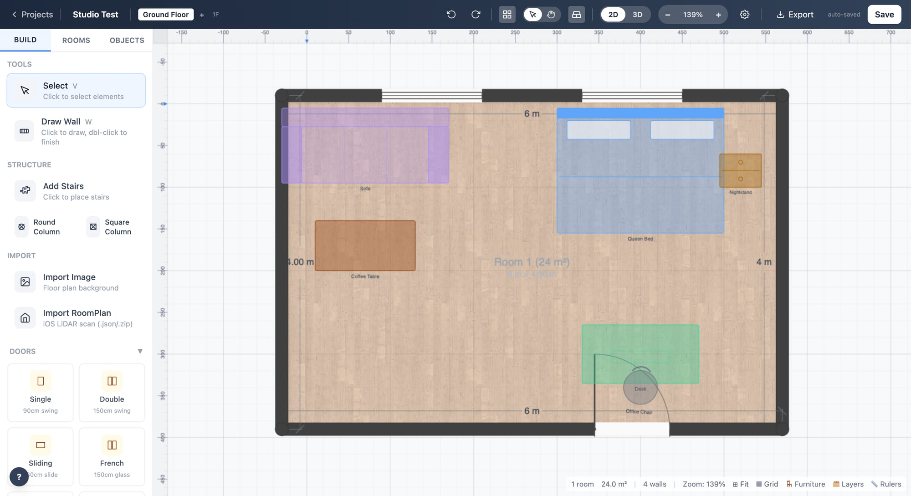
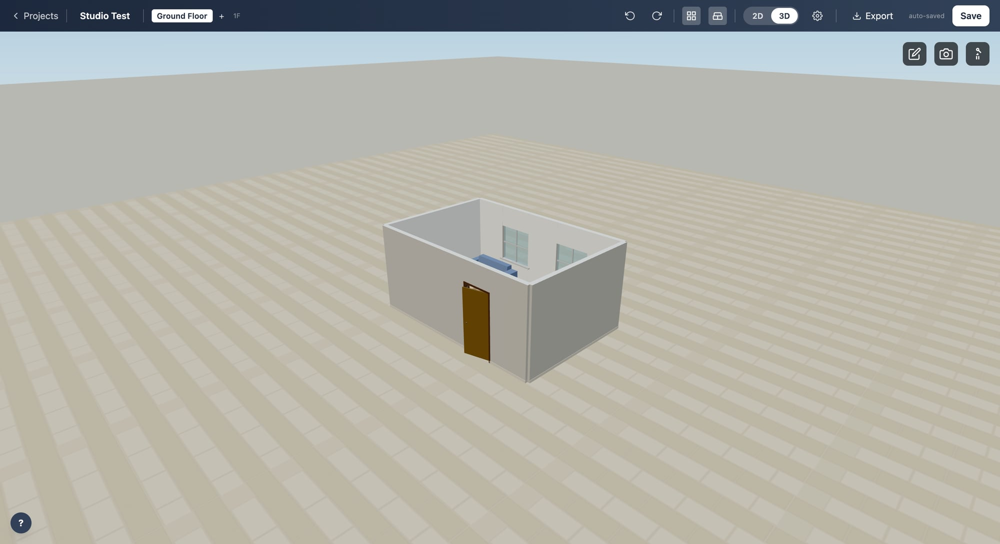
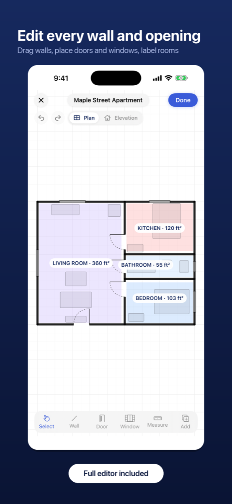

# Planejador 3D

Desenhe a planta de uma casa em 2D e veja na hora em 3D, direto no navegador —
do computador ou do celular. Em português, de graça, sem cadastro e sem
servidor: tudo roda e fica guardado no seu próprio aparelho.

<p align="center">
  
  
</p>

## O que dá para fazer

- **Desenhar paredes** com encaixe na grade, comprimento digitado e espessura por parede.
- **Portas e janelas** de vários tipos, posicionadas sobre a parede.
- **Ambientes detectados sozinhos**, com nome, piso e área em metros quadrados.
- **Vários pavimentos**, com cota própria e vista empilhada em 3D.
- **Catálogo de móveis**, mais importação de modelos `.glb` seus.
- **Cotas e anotações**, internas e externas, com linhas de chamada.
- **Vista 3D** com modo de passeio e câmera fotográfica.
- **Exportar** em PNG, PDF, SVG, DXF, DWG e JSON, e imprimir em escala (A4 ou A3).
- **Importar** escaneamentos RoomPlan feitos no iPhone.
- **Funciona offline** e pode ser instalado na tela inicial do celular.

Tudo em metros e centímetros, do jeito que se usa aqui.

## No celular



A tela pequena tem um formato próprio: uma barra inferior com as ações do dia a
dia — Ferramentas, Selecionar, Parede, Porta, Janela e Móveis — em botões
grandes, o painel de ferramentas como gaveta que fecha sozinha, um dedo para
desenhar e dois dedos para zoom. Dá para instalar na tela inicial e usar como
aplicativo, inclusive sem internet.

## Rodando no seu computador

Precisa do [Node.js](https://nodejs.org) 24 ou mais novo.

```bash
npm install
npm run dev
```

Abra o endereço que aparecer no terminal. Para testar do celular na mesma
rede, use `npm run dev -- --host` e abra o endereço de rede no telefone.

Para gerar os arquivos do site publicado:

```bash
npm run build      # gera a pasta build/
npm run preview    # abre essa pasta como se já estivesse publicada
```

## Publicando na Vercel

O projeto já sai configurado como site estático, que a Vercel publica de graça
e sem configuração nenhuma:

1. Suba este repositório para o GitHub.
2. Na Vercel, clique em **Add New → Project** e escolha o repositório.
3. Confirme. A Vercel reconhece o SvelteKit sozinha e publica.

Cada envio para a branch `main` publica de novo.

## Como está organizado

```
src/
  routes/        páginas (tela inicial e editor)
  lib/
    components/  a interface (barra superior, painéis, tela de desenho, vista 3D)
    stores/      o estado compartilhado (projeto, configurações, histórico)
    utils/       geometria, exportações, catálogo de móveis
    i18n/        os textos da interface
static/          ícones, texturas e modelos 3D
docs/            guia do usuário e documentação
tests/           testes (vitest) e testes de navegador (playwright)
```

## Testes

```bash
npm test           # testes de unidade
npm run check      # conferência de tipos
npm run test:browser   # testes de navegador (precisa do Playwright instalado)
```

## Documentação

- [Guia do usuário](docs/guia-do-usuario.md) — o passo a passo completo
- [Modelos 3D próprios](docs/modelos-3d-proprios.md) — importando seus arquivos `.glb`
- [Pacote de projeto](docs/pacote-de-projeto.md) — o formato que leva um projeto de um aparelho a outro
- [Catálogo de móveis](docs/catalogo-de-moveis.md) — como o catálogo é conferido e de onde vêm os modelos

## Licença e créditos

MIT — veja [LICENSE](LICENSE).

Este projeto é uma versão derivada do
[openPlan3D / open3dFloorplan](https://github.com/theLodgeBots/open3dFloorplan),
de theLodgeStudio, adaptada para o português e para uso no celular. Os créditos
dos modelos 3D do catálogo estão em [MODEL_SOURCES.md](MODEL_SOURCES.md).
